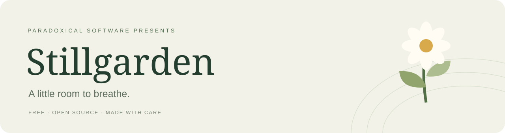
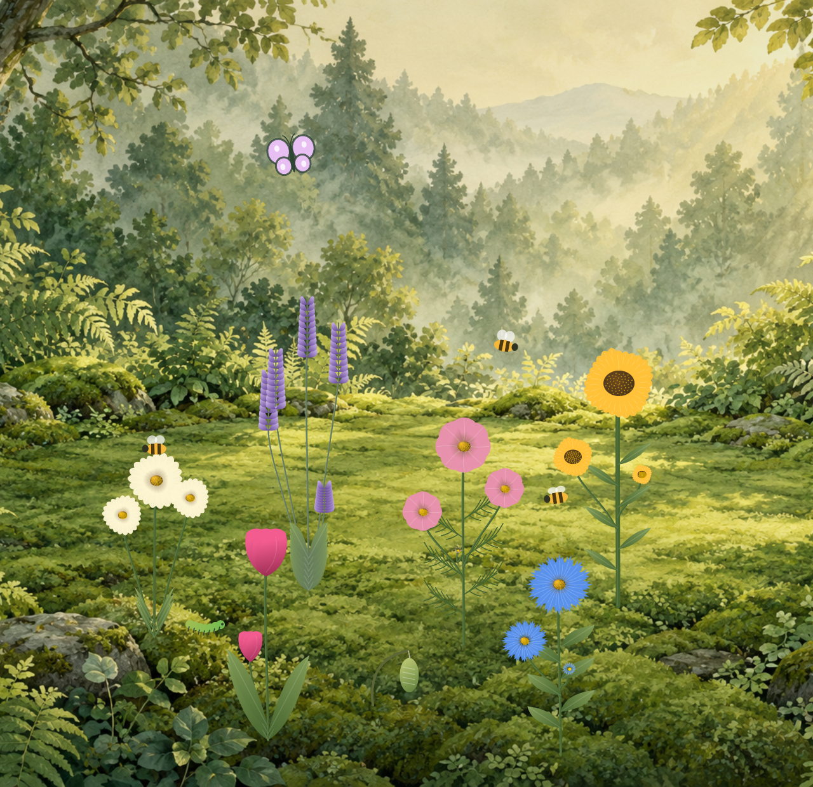
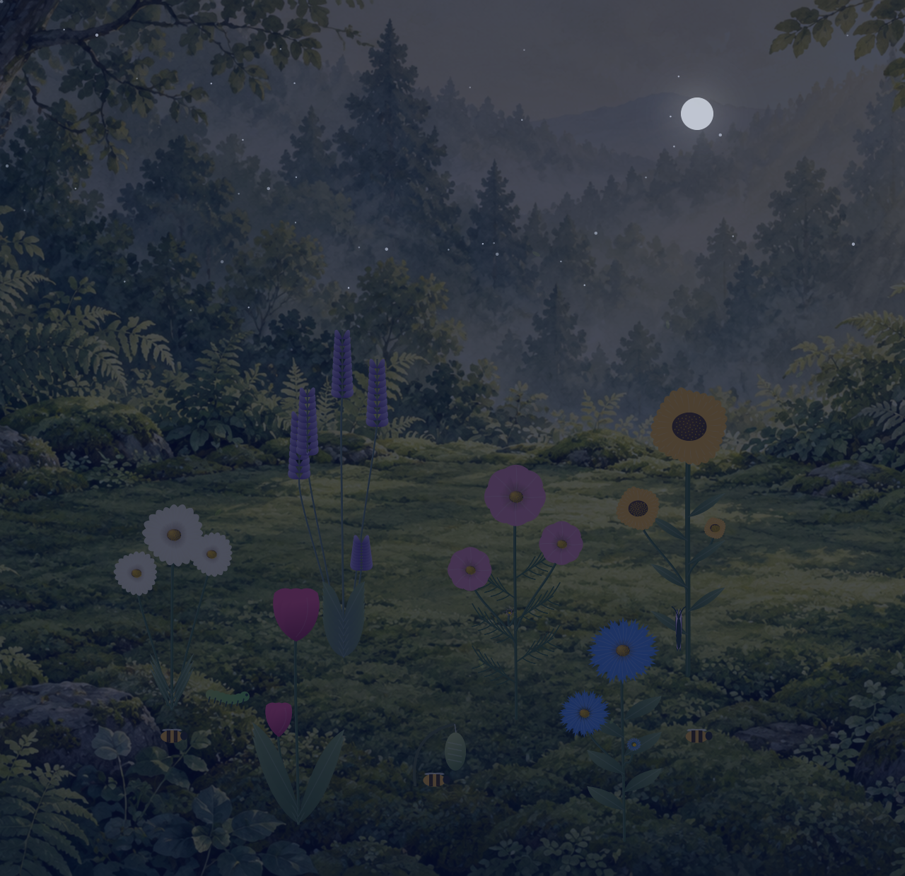
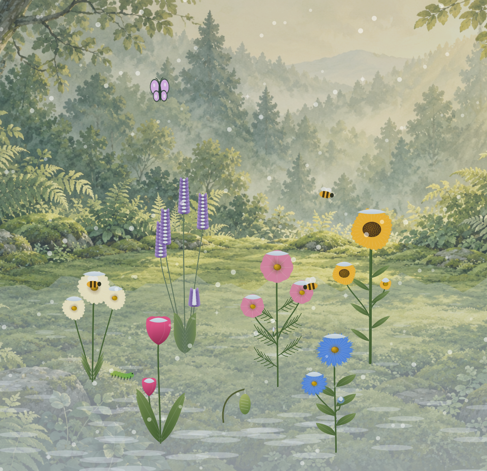
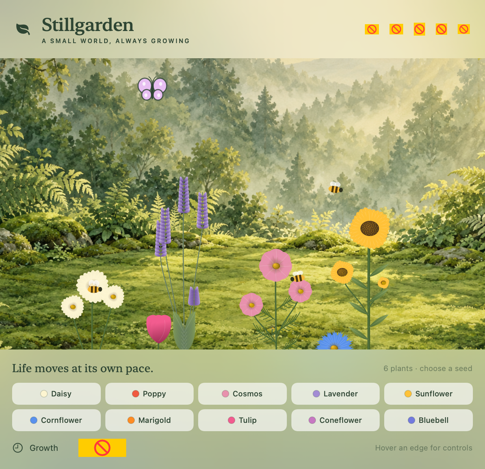

<p align="center"></p>

<p align="center">
  <a href="https://github.com/paradoxicalsoftware/Stillgarden/releases/latest"></a>
  <a href="LICENSE"></a>
  
  <a href="https://github.com/paradoxicalsoftware/Stillgarden/stargazers"></a>
</p>

<p align="center"><b>A living garden above your desktop. A small invitation to pause.</b><br>
Mac · Windows · Linux · Web<br>Free, open source, and made with care by <a href="https://paradoxicalsw.com">Paradoxical Software</a>.</p>

<p align="center"><a href="https://paradoxicalsoftware.github.io/Stillgarden/">Explore the garden</a> · <a href="https://github.com/paradoxicalsoftware/Stillgarden/releases/latest">Download the app</a> · <a href="https://paradoxicalsoftware.github.io/Stillgarden/play/">Play in your browser</a> · <a href="CONTRIBUTING.md">Help it grow</a></p>

<p align="center"></p>

## A labor of love

Stillgarden began with a simple wish: make a small green space that can stay with you while you work. Plant a flower. Watch a butterfly settle for the night. Let the rain pass. There is nothing to win and no streak to protect.

We're sharing it freely in support of mental health and the everyday practice of making room for a pause. This is a personal, creative project—not a medical product or a substitute for care. Take what feels helpful, mute what doesn't, and make the garden your own.

**If this little garden makes your desktop feel kinder, give it a star.** It helps other people find it, and helps us see that this kind of software matters to someone.

## Your own small world

- **A garden that stays close.** Pin it above other apps. Hide every control; hover an edge to bring them back. Optional gentle visits fade the garden away and return it later.
- **Flowers with room to grow.** Ten varieties with distinct petals, leaves, stems and branching. Speed up a single plant, bloom it instantly, or let it grow in its own time.
- **A living habitat.** Bees turn with their flight. Caterpillars become cocoons and butterflies. Pollinators rest overnight and wake gradually at dawn.
- **Daylight at your pace.** Follow your Mac's clock, hold a chosen hour, or run an accelerated day. Light, stars and sound change smoothly.
- **Weather with a little wonder.** Calm breezes, windy spells, rain, branching lightning and individually delayed thunder. Seasons follow the calendar or your choice.
- **Winter that lingers.** Snow settles on the ground and flowers, stays in the cold, and gradually melts as conditions warm—even across restarts.
- **Sound you control.** Seasonal birdsong, crickets, a real owl call, rain and wind. Mute everything or choose a comfortable volume.
- **A fresh start, safely.** Reset the garden while keeping your settings. Undo the last reset, including after reopening the app.

**A small secret:** triple-click the open sky for **God mode**. Change time, weather and season, or give your plants a little extra time to grow.

| After dark | A winter pause |
| --- | --- |
|  |  |

<details><summary>See the planting controls</summary>



</details>

*Gallery images are rendered from the app's actual SwiftUI views with staged gardens, not mockups. Your garden will grow differently.*

## Download and open

**[Open the web garden →](https://paradoxicalsoftware.github.io/Stillgarden/play/)** or download a desktop edition from **[Releases](https://github.com/paradoxicalsoftware/Stillgarden/releases/latest)**.

| Platform | Choose |
| --- | --- |
| macOS 13+ · Apple silicon and Intel | `Stillgarden-1.1.0-macOS-universal.zip` — unzip and move to Applications |
| Windows 10/11 · x64 | `Stillgarden-1.1.0-Windows-x64-Setup.exe` |
| Linux · x64 | AppImage or `.deb` package |
| Web · desktop and mobile | Current browser; saves stay in that browser |

The Windows and Linux editions share the web garden engine. The original Mac app remains native SwiftUI. Desktop editions can stay above your apps; Linux Wayland window placement depends on your compositor. The web edition stays in its tab. See [platform support, installation details and known limitations](PLATFORM_SUPPORT.md).

**Community builds:** Windows is unsigned, and Mac is ad-hoc signed and **not Apple-notarized**. Your operating system may block first launch. Review the source and release checksums; for Mac, see [Apple's guidance for opening trusted software](https://support.apple.com/en-us/102445). Intel Mac is cross-compiled but not yet tested on Intel hardware.

No account. No ads. No analytics. Desktop gardens run locally; the web garden downloads its assets and saves locally. [Privacy details](PRIVACY.md).

## Build from source

For the **native Mac app**, install Xcode Command Line Tools and use a current Swift toolchain (Swift 6 recommended; release built with Swift 6.3).

```sh
git clone https://github.com/paradoxicalsoftware/Stillgarden.git
cd Stillgarden
./scripts/build.sh           # Build for this Mac
./scripts/test.sh
open build/Stillgarden.app
```

For a universal release:

```sh
./scripts/build.sh universal
./scripts/test.sh
./scripts/package.sh
```

No third-party Swift packages are required. The app uses AppKit, SwiftUI and AVFoundation. Included audio assets play without Python; regenerating synthesized audio requires Python, NumPy and macOS `afconvert`.

The save file lives at `~/Library/Application Support/Stillgarden/garden.json`. Reset creates `before-reset.json` in the same directory. Don't put either file in an issue or commit unless you've reviewed its contents.

For **Windows, Linux and web development**, use Node.js 22+: `npm ci`, `npm test`, then `npm start`. See the [portable build guide](PLATFORM_SUPPORT.md#development).

## Help this garden grow

Bug reports, accessibility improvements, botanical details, thoughtful sound design and small contributions are welcome. You do not need to be an expert. Start with the [contribution guide](CONTRIBUTING.md), [roadmap](ROADMAP.md), and [Code of Conduct](CODE_OF_CONDUCT.md).

A useful first contribution might be testing on an Intel Mac, improving keyboard access, or explaining where a flower's growth feels wrong. Please open an issue before a large redesign. We want to keep the app calm, understandable and lightweight.

## Made by Paradoxical Software

We build useful software with curiosity and care. Stillgarden is our public, open-source labor of love.

**[Visit paradoxicalsw.com →](https://paradoxicalsw.com)**

Code and original project assets are available under the [MIT License](LICENSE). The recorded owl call is CC0. See [credits and asset provenance](CREDITS.md). Development was AI-assisted; the painted backdrop is AI-generated, while flowers and animation are drawn procedurally in SwiftUI.
